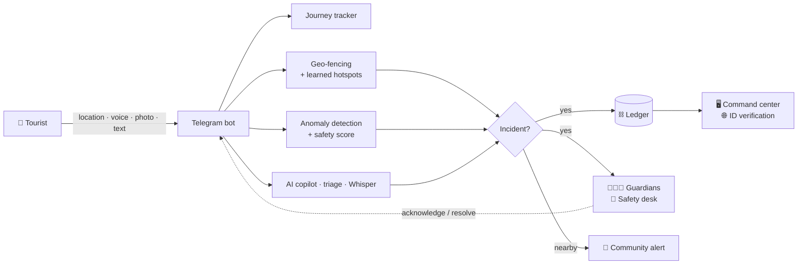

<div align="center">

# 🛡️ Travel Buddy

### Smart Tourist Safety Monitoring & Incident Response System
**AI · Geo-Fencing · Blockchain-based Digital ID**

A Telegram travel companion that keeps tourists safe in real time. It tracks journeys, warns about risky areas, detects emergencies automatically and gets help to them fast. Authorities get a live command center.

[](https://www.python.org/)
[](https://python-telegram-bot.org/)
[](https://console.groq.com/)
[](https://www.openstreetmap.org/)
[](https://www.sqlite.org/)

[Features](#-features) · [Quick start](#-quick-start) · [Commands](#-command-reference) · [Architecture](docs/ARCHITECTURE.md) · [Testing](#-testing)


<sub><i>Web Command Center: live tourists, geo-fences, learned hotspots and a prioritised incident queue (demo data).</i></sub>

</div>

---

## 📑 Table of contents

- [Overview](#-overview)
- [Features](#-features)
- [How it works](#-how-it-works)
- [Tech stack](#-tech-stack)
- [Project structure](#-project-structure)
- [Quick start](#-quick-start)
- [Running cost: ₹0](#-running-cost-0)
- [Configuration](#%EF%B8%8F-configuration)
- [Deployment](#-deployment)
- [Command reference](#-command-reference)
- [Web portal](#-web-portal)
- [Testing](#-testing)
- [Security & privacy](#-security--privacy)
- [Roadmap](#%EF%B8%8F-roadmap)
- [Contributing](#-contributing)
- [Acknowledgements](#-acknowledgements)

---

## 🌏 Overview

Tourists in unfamiliar places, especially remote, border or hazard-prone regions, face risks that existing tools handle poorly. Help arrives late because nobody knows where they are, families can't see that something is wrong, and authorities have no verified identity or live picture.

**Travel Buddy** works inside Telegram, so there is no app to install. It combines:

| Pillar | What it delivers |
|---|---|
| 🪪 **Blockchain Digital ID** | A tamper-evident tourist ID with QR verification that police, hotels and guides can check instantly. |
| 🗺️ **Geo-fencing** | Alerts on approaching, entering and leaving risk zones, plus danger zones learned automatically from incident reports. |
| 🤖 **AI monitoring** | Detects sudden halts, long stops, route deviation and lost signal, with check-ins that escalate when unanswered. |
| 🚨 **Incident response** | One-tap or voice SOS, AI-triaged reports, a sealed evidence vault, guardian and authority alerts, and E-FIR drafts. |

---

## ✨ Features

<details open>
<summary><b>🪪 Blockchain-based Digital Tourist ID</b></summary>

- 6-step registration that issues a `TID-XXXXXXXXXX` ID, valid for the length of the trip
- Each ID is sealed in a **SHA-256 hash-chained, proof-of-work ledger**. Editing any record or block is detected.
- **QR code** opens a public verification page; `/verifyid` checks an ID from inside Telegram
- Privacy by design: the document number is **never stored** (only a salted hash), and the message containing it is deleted from the chat
- SOS events, incidents, resolutions and evidence are written to the same immutable audit trail

</details>

<details open>
<summary><b>🗺️ Geo-fencing & risk intelligence</b></summary>

- Risk zones (🟢 safe · 🟡 caution · 🟠 high · 🔴 restricted) with **approach** warnings 1 km before the edge, plus **enter** and **exit** alerts
- Entering a restricted zone creates an incident and notifies guardians and the safety desk
- **Self-learning hotspots:** incident reports are clustered (DBSCAN-style) into dynamic danger zones, weighted by recency and severity
- **Severe-weather watch** (Open-Meteo): thunderstorms, heavy rain (landslide and flood risk), fog, extreme heat or cold, strong winds
- **`/saferoute`:** the real road route is scored against zones, hotspots, weather and time of night, with reasons
- Nearest police, hospitals and pharmacies (OpenStreetMap) and country-specific emergency numbers

</details>

<details open>
<summary><b>🤖 AI monitoring & assistance</b></summary>

- **Anomaly detection** during trips: abrupt halt (possible accident), prolonged stop, route deviation, lost signal
- **Check-ins** with ✅ *I'm safe* / 🆘 *I need help* buttons. No answer means automatic escalation.
- **Safety score (0–100)** from zone risk, time of night, incidents, anomalies, weather, hotspots and preparedness
- **AI Safety Copilot:** just type a message. It answers using your live location, zone, weather and nearby hotspots, in your language.
- **AI incident triage** (category, severity and first-response advice). It can never rank an emergency lower than the rule-based classifier does.
- **AI safety briefings** for any destination, plus an emergency **phrasebook** (Hindi, Bengali, Tamil, Spanish, French, Japanese and AI translation)

</details>

<details open>
<summary><b>🚨 Incident response</b></summary>

- **SOS** by command, persistent 🆘 button or **voice note in any language** ("help", "bachao", "बचाओ", "au secours", "助けて"…)
- Location, Digital ID and emergency contact are sent to **guardians** and the **safety desk**, with Acknowledge / Resolve buttons
- **Evidence vault:** photos and voice notes are fingerprinted (SHA-256), sealed on the ledger and forwarded to responders
- **E-FIR draft** with movement trail, evidence hashes and ledger proof, ready to file with the police
- **Safety timer** (`/timer 90`) for hikes and nights out
- Anonymous **community alerts** for travellers within 2 km of a reported incident

</details>

<details>
<summary><b>🚆 Journey companion (core)</b></summary>

- Trip wizard with station geocoding; live GPS tracking with smoothed speed and ETA
- Stop alert when ETA ≤ 4 min or distance ≤ 1 km, auto-arrival at 150 m, overshoot detection
- Personalised AI travel guide (`/explore`) grounded in fresh web search results

</details>

---

## 🧠 How it works



See **[docs/ARCHITECTURE.md](docs/ARCHITECTURE.md)** for the package layout, sequence diagrams, data model, ledger design and every detection threshold.

---

## 🧰 Tech stack

| Layer | Technology |
|---|---|
| Bot framework | [python-telegram-bot](https://python-telegram-bot.org/) 21 (asyncio) |
| AI | [Groq](https://console.groq.com/): Llama 3.3 70B (guide, triage, copilot) and Whisper large-v3-turbo (voice) |
| Search grounding | DuckDuckGo (`ddgs`) |
| Maps & geodata | OpenStreetMap Nominatim, Overpass, OSRM routing, Leaflet |
| Weather | Open-Meteo |
| Storage | SQLite via `aiosqlite` |
| Ledger | SHA-256 hash chain with proof-of-work (built in) |
| Web portal | Python standard library HTTP server, Leaflet, hand-built CSS and JavaScript (no framework) |
| QR codes | `segno` |

---

## 💸 Running cost: ₹0

Everything Travel Buddy uses is free, and the bot has built-in guards so it **cannot** run past a free tier.

| Service | Used for | Price | Free-tier guard in the bot |
|---|---|---|---|
| Telegram Bot API | Messaging, files, location | Free | — |
| OpenStreetMap Nominatim | Addresses, place search | Free (fair use) | Max 1 request/second, results cached 1–7 days |
| OpenStreetMap Overpass | Nearest police, hospitals, pharmacies | Free (fair use) | 10 s budget, mirrors, Nominatim fallback, 6 h cache, `PLACES_DAILY_LIMIT` |
| OpenStreetMap tiles + Leaflet | Web command-center map | Free | Loaded by the browser only when the map is open |
| Open-Meteo | Weather hazards | Free for non-commercial use (<10,000 calls/day) | 15 min cache, `WEATHER_DAILY_LIMIT` = 5,000 |
| OSRM demo server | `/saferoute` road routes | Free (light use) | `ROUTING_DAILY_LIMIT` = 500, straight-line fallback |
| DuckDuckGo | Web search for the AI guide | Free | — |
| Groq (optional) | AI copilot, triage, voice, guide | **Free tier, no card required** | `AI_DAILY_LIMIT` = 300; then offline mode until tomorrow |
| Python packages | — | Open source | — |
| Hosting | Your own PC | Free | — |

- **Groq can only charge you if you add a payment method to your Groq account.** Don't add one and it stays free forever. Without any key, all AI features use their offline fallbacks.
- When a daily cap is reached, that feature quietly switches to its offline mode until 00:00 UTC. **SOS, geo-fencing, check-ins, guardians and the ledger never stop.**
- Admins can check today's usage against every cap with **`/usage`** in the bot.
- *Going commercial?* Open-Meteo needs a paid licence for commercial use, and heavy production use should run its own OSRM/Nominatim servers (both are free, open-source software).

---

## 📁 Project structure

```
Travel-Buddy/
├── main.py                     # Entry point: wires handlers, monitor loop and web portal
├── travel_buddy/
│   ├── core/                   # Persistence, GPS tracking, geocoding
│   │   ├── database.py
│   │   ├── tracker.py
│   │   └── geocoding.py
│   ├── ai/                     # Groq-powered intelligence
│   │   ├── travel_guide.py     #   /explore recommendations
│   │   ├── triage.py           #   incident classification & safety briefings
│   │   └── copilot.py          #   copilot, voice, distress detection, phrasebook
│   ├── safety/                 # Safety platform
│   │   ├── ledger.py           #   blockchain ledger & Digital Tourist ID
│   │   ├── geofence.py         #   zones, emergency services & numbers
│   │   ├── monitor.py          #   anomaly detection & safety score
│   │   ├── incidents.py        #   incidents, responders, check-ins, monitor loop
│   │   ├── risk_intel.py       #   hotspots, weather, safe routes
│   │   ├── actions.py          #   shared actions used by both the bot and the website
│   │   └── store.py            #   safety schema & queries
│   ├── bot/                    # Telegram interface
│   │   ├── handlers.py         #   start/help, trips, live location, AI guide
│   │   ├── safety_handlers.py  #   ID, guardians, SOS, reports, E-FIR, admin
│   │   ├── intel_handlers.py   #   copilot, voice, evidence, routes, weather, QR
│   │   └── keyboards.py
│   └── web/
│       ├── dashboard.py        # HTTP server, JSON API, data access
│       ├── pages.py            # HTML views (landing, login, portal, verify, ledger, command center)
│       ├── auth.py             # passwordless Telegram sign-in, sessions
│       ├── portal_api.py       # tourist / guardian / officer JSON API
│       ├── runtime.py          # runs web actions on the bot's event loop
│       └── static/             # Design system CSS, page scripts, favicon
│   └── config.py               # start-up configuration checks
├── scripts/
│   ├── preflight.py            # pre-deployment check (config, database, token, port)
│   ├── backup_db.py            # online SQLite backup with rotation
│   └── run_tests.py            # runs every offline test suite
├── deploy/
│   ├── travel-buddy.service    # systemd unit (Linux server without Docker)
│   └── Caddyfile               # reverse proxy with automatic HTTPS
├── tests/                      # Offline & integration test suites
├── docs/
│   ├── ARCHITECTURE.md
│   ├── DEPLOYMENT.md
│   └── assets/
├── .github/workflows/ci.yml    # lint + tests on every push
├── Dockerfile · docker-compose.yml
├── requirements.txt            # exact pinned versions
└── .env.example
```

---

## 🚀 Quick start

### Prerequisites

- Python **3.10+** (developed on 3.12)
- A Telegram bot token from [@BotFather](https://t.me/BotFather)
- *(Optional)* A free [Groq API key](https://console.groq.com/) for the AI features. Without one, rule-based fallbacks are used.

### Installation

```bash
git clone https://github.com/BHUVANESHv7/Travel-Buddy.git
cd Travel-Buddy

python -m venv venv
# Windows
venv\Scripts\activate
# macOS / Linux
source venv/bin/activate

pip install -r requirements.txt
```

### Configure and run

```bash
cp .env.example .env        # Windows: copy .env.example .env
# edit .env and set BOT_TOKEN and ADMIN_IDS (GROQ_API_KEY is optional)
python scripts/preflight.py # checks the setup before you start
python main.py
```

Open your bot in Telegram and send `/start`. The web portal starts at **http://localhost:8080**.

A fresh database contains **no sample data**: the safety desk adds the real risk zones with `/addzone` or the **Desk** tab of the command center. For a quick demo on a fresh database, set `SEED_STARTER_ZONES=1` once to load five sample zones (Kaziranga, Nathu La, Cherrapunji, Tawang, Jaipur Old City).

### Five-minute tour

1. `/registerid` → you get a Digital Tourist ID and a QR code.
2. `/addguardian Mum` → open the invite link from a second Telegram account.
3. As an admin, add a zone (`/addzone restricted 3000 <lat> <lng> Test area | Permit only`), then share a location inside it. You get a restricted-zone alert, and the guardian is notified with a map pin.
4. Tap **🆘 SOS**. The guardian taps **👀 Acknowledge**, and you see that they're responding.
5. Send a photo captioned *"my bag was snatched"*. It's sealed as evidence. Then run `/efir <id>`.
6. Put your Telegram ID in `ADMIN_IDS`, restart, and open the command-center link the bot sends you.

---

## ⚙️ Configuration

All settings live in `.env` (see [`.env.example`](.env.example)).

| Variable | Required | Default | Description |
|---|:---:|---|---|
| `BOT_TOKEN` | ✅ | — | Telegram bot token from @BotFather |
| `GROQ_API_KEY` | | — | Enables the AI guide, triage, copilot, briefings and voice transcription |
| `GROQ_MODEL` | | `llama-3.3-70b-versatile` | Groq chat model |
| `ADMIN_IDS` | | — | Comma-separated Telegram IDs of the safety desk (send `/dashboard` to see yours) |
| `SAFETY_INACTIVITY_MIN` | | `30` | Minutes without location during a trip before a check-in |
| `SAFETY_ESCALATE_MIN` | | `15` | Minutes to answer a check-in before responders are alerted |
| `WEB_ENABLED` | | `1` | Set to `0` to disable the web portal |
| `WEB_HOST` / `WEB_PORT` | | `127.0.0.1` / `8080` | Web portal bind address |
| `WEB_PORT_FALLBACK` | | `1` | `1`: if the port is busy, use the next free one (laptop). `0`: fail instead (servers, Docker) |
| `TRUST_PROXY` | | `0` | Set to `1` behind Caddy / nginx / Cloudflare Tunnel so rate limits see real visitor IPs |
| `DASHBOARD_TOKEN` | | random | Secret for the command-center link. If unset, one is generated once, stored in the database (kept across restarts) and sent to admins at start-up |
| `PUBLIC_BASE_URL` | | `http://localhost:8080` | Public HTTPS URL used in QR codes and sign-in links. `https://` also turns on Secure cookies and HSTS |
| `DATABASE_PATH` | | `./travel_bot.db` | SQLite database location |
| `LOG_FILE` · `LOG_LEVEL` | | `travel_buddy.log` · `INFO` | Rotating log file (5 × 2 MB); empty `LOG_FILE` = console only |
| `SEED_STARTER_ZONES` | | `0` | `1` loads five sample zones into an empty database (demos only) |
| `AI_DAILY_LIMIT` | | `300` | Max Groq AI calls per day (then offline mode) |
| `WEATHER_DAILY_LIMIT` · `ROUTING_DAILY_LIMIT` · `PLACES_DAILY_LIMIT` | | `5000` · `500` · `2000` | Daily caps for the other free services |

---

## 🚢 Deployment

Travel Buddy is one process (bot + web portal + safety monitor) with one SQLite file, so it runs on any small machine, including free tiers. Full guide: **[docs/DEPLOYMENT.md](docs/DEPLOYMENT.md)**.

```bash
python scripts/preflight.py          # must say READY
docker compose up -d --build         # or: deploy/travel-buddy.service with systemd
```

- **Health check:** `GET /healthz` returns `200` when the database and the bot are up (used by Docker's `HEALTHCHECK`)
- **HTTPS:** put the portal behind [Caddy](deploy/Caddyfile) or a free Cloudflare Tunnel, set `PUBLIC_BASE_URL=https://…` and `TRUST_PROXY=1`
- **Backups:** `python scripts/backup_db.py` takes a consistent snapshot while running; schedule it daily
- **Logs:** rotate automatically; the command-center secret is never written to them

---

## 📖 Command reference

<details open>
<summary><b>🚨 Safety & incidents</b></summary>

| Command | Description |
|---|---|
| `/sos` · 🆘 button · voice note | Emergency alert with location to guardians and the safety desk |
| `/report` | Guided incident report with AI triage |
| `/safety` | Live safety score and status |
| `/nearby` | Closest police, hospitals and emergency numbers |
| `/zones` · `/hotspots` | Geo-fenced risk zones and learned incident hotspots nearby |
| `/weather` | Weather hazards now and for the next 6 hours |
| `/saferoute <place>` | Route safety analysis with directions |
| `/timer <min>` · `/safe` | Safety timer and "I'm okay" |
| `/incidents` · `/resolve <id>` · `/efir <id>` | Manage incidents and draft a police report |
| `/monitoring on\|off` · `/community on\|off` | Toggle anomaly detection and community alerts |

</details>

<details>
<summary><b>🪪 Identity, guardians & AI</b></summary>

| Command | Description |
|---|---|
| `/registerid` · `/myid` · `/verifyid <TID>` · `/revokeid` | Digital Tourist ID lifecycle |
| `/ledger` | Ledger status and recent blocks |
| `/addguardian <name>` · `/guardians` · `/removeguardian <id>` | Emergency contacts |
| `/whereis` | Guardians: last location of the people they guard |
| `/login` | One-tap sign-in link for your web portal |
| `/ask <question>` *(or just type)* | AI Safety Copilot |
| `/safetytips <place>` | AI safety briefing |
| `/phrases [language] [text]` | Emergency phrasebook and translation |
| 📸 photo with caption | Sealed evidence attached to an incident |

</details>

<details>
<summary><b>🚆 Journeys & travel guide</b></summary>

| Command | Description |
|---|---|
| `/newtrip` · `/mytrip` · `/endtrip` · `/canceltrip` | Plan and track a journey (share **Live Location** to start tracking) |
| `/explore <question>` · `/preferences` | Personalised AI travel recommendations |

</details>

<details>
<summary><b>👮 Safety desk (ADMIN_IDS)</b></summary>

| Command | Description |
|---|---|
| `/dashboard` | Live counts, priority queue, tourists in risk zones, ledger health |
| `/incidents all` | All open incidents |
| `/whereis <TID>` | Last known location of any tourist |
| `/addzone <risk> <radius_m> <lat> <lng> <name> \| <advisory>` · `/removezone <id>` | Manage geo-fences |
| `/web` | Command-center link |

</details>

---

## 🖥️ Web portal

Every role can use the website as well as Telegram, with the same features on both (voice notes aside, since the web has a hold-to-send SOS button). Both channels share **one implementation** (`travel_buddy/safety/actions.py`), so they always behave the same.

| Who | Where | What they can do on the web |
|---|---|---|
| 🧳 **Tourist** | `/login` → `/app` | Live safety score & map, share location / live journey tracking, **hold-to-send SOS**, "I'm safe", report incidents (AI triage), **photo evidence upload**, E-FIR download, Digital ID (register, QR, verify, revoke), guardians (invite, remove), trips with stop alerts, safe-route check, nearby help, safety timer, settings, and an **Assistant** tab (AI copilot chat, safety briefing, emergency phrasebook + AI translation, personalised travel guide) |
| 👨‍👩‍👧 **Guardian / parent** | `/login` → `/app` → **Family** | Live status, location trail and safety score of each person they protect; missed check-in and SOS banners; **acknowledge / resolve** incidents (the tourist is told on Telegram); E-FIR |
| 👮 **Officer (safety desk)** | `/login` (admin account) → `/command` | Live command-center map, incident queue with **Acknowledge / Resolve** buttons, hotspots, ledger health, and a **Desk** tab to add/remove geo-fence zones (click the map to place them) and watch free-tier usage |

**Sign-in uses the Telegram account, with no passwords.** Either:
1. On `/login`, enter your Telegram @username, Telegram ID or Tourist ID; the bot sends a 6-digit code to your Telegram (valid 10 min, 5 attempts), **or**
2. Send `/login` to the bot and tap the one-time link (valid 15 min, single use).

Sessions are random tokens stored only as hashes, in HttpOnly SameSite cookies, with CSRF protection on every action. The login form never reveals whether an account exists.

| Route | Access | Purpose |
|---|---|---|
| `/` | Public | Portal landing page |
| `/login` · `/app` | Tourist / guardian sign-in | Personal safety portal |
| `/verify/<TID>` | Public | Digital ID verification (QR code target) |
| `/ledger` | Public | Ledger explorer (hashes only) |
| `/command` | 🔒 Admin sign-in or token link | Live command-center map + officer actions |
| `/api/me/*`, `/api/family`, `/api/incident/*` | 🔒 Session | JSON API behind the portal |

> 📍 Browsers only share location on `localhost` or **HTTPS**. To use the portal from a phone, expose it over HTTPS (for example `ngrok http 8081`) and set `PUBLIC_BASE_URL`.

<p align="center">
  
</p>

**Interface highlights**

- **Command center:** count-up KPI tiles that flash when values change; pulsing map markers by severity; a flashing banner and red vignette for critical alerts; slide-in toasts and optional alert sounds for new incidents. Also has tabs for incidents, tourists, hotspots and activity, with search and severity filters, and fly-to-incident on click.
- **ID verification:** a holographic ID card that tilts with the pointer; verification checks that tick one by one; an animated VALID / INVALID stamp.
- **Ledger explorer:** an animated chain timeline, expandable block payloads and click-to-copy hashes.
- **Throughout:** dark "aurora" theme, glass panels, reveal-on-scroll, responsive down to phone width, keyboard focus styles, and full support for the *reduced motion* accessibility setting.

To let phones open QR links, expose the portal (for example `ngrok http 8080`) and set `PUBLIC_BASE_URL`.

---

## 🧪 Testing

```bash
python tests/test_safety.py         # ledger tamper detection, ID lifecycle, geo-fencing, anomalies, escalation
python tests/test_intel.py          # hotspots, weather, safe routes, distress detection, evidence, QR, web portal
python tests/test_trips.py          # trip lifecycle & state transitions
python tests/simulate_live_trip.py  # live GPS simulation: alerts, arrival, overshoot
python tests/test_ai_guide.py       # preferences + web search grounding (needs internet)
python tests/test_costs.py          # zero-cost guards: daily caps, AI fallback, rate limits, caches
python tests/test_portal.py         # web portal: sign-in, CSRF, tourist & guardian actions, permissions, officer actions
python tests/test_deploy.py         # production readiness: config checks, clean database, /healthz, proxy IPs, backups
python scripts/run_tests.py         # all of the above in one go (also runs in GitHub Actions)
python tests/live_check.py          # LIVE end-to-end run through the real Telegram API (see below)
```

The safety and intelligence suites run fully offline against a temporary database. No test touches your real `travel_bot.db`; the live check also uses a temporary database unless you pass `--real-db`.

**Live end-to-end check.** After pressing **Start** in your bot once, `tests/live_check.py` sends a scripted session through the bot's real handlers: 40 checks covering ID registration with QR, geo-fencing, live journey tracking and arrival, reports, E-FIR, SOS, admin dashboard and the AI guide. Every reply is delivered to your Telegram chat in real time, and every Bot API call is verified. It uses the first ID in `ADMIN_IDS`, or `--chat-id`.

---

## 🔐 Security & privacy

- **No raw ID numbers stored:** only a salted SHA-256 hash and the last 4 characters
- **Ledger holds no personal data:** blocks contain IDs, hashes, types and severities only
- **Tamper evidence:** chain re-verification plus identity-hash comparison against the database
- **Least exposure:** community alerts are anonymous with approximate distance; the command center needs a secret token; the portal binds to localhost by default
- **Secrets stay local:** `.env`, the database and logs are git-ignored; the command-center token is masked in logs
- **Hardened web server:** CSRF header + token on every action, HttpOnly SameSite cookies (Secure + HSTS on HTTPS), request size limits, per-IP rate limits, `X-Frame-Options: DENY`

> ⚠️ Travel Buddy supports, but does not replace, official emergency services. In danger, always call the local emergency number (e.g. **112** in India).

---

## 🗺️ Roadmap

- [ ] Multilingual bot interface (Hindi, regional languages)
- [ ] Anchoring ledger block hashes to a public blockchain
- [ ] Offline SMS fallback for SOS in low-connectivity areas
- [ ] Wearable / panic-button integration
- [ ] Authority-side incident assignment and response-time analytics

---

## 🤝 Contributing

Contributions are welcome!

1. Fork the repository and create a feature branch: `git checkout -b feature/my-feature`
2. Keep changes focused and add or extend tests in `tests/`
3. Run the test suites
4. Open a pull request describing the change

---

## 🙏 Acknowledgements

[python-telegram-bot](https://python-telegram-bot.org/) · [Groq](https://groq.com/) · [OpenStreetMap](https://www.openstreetmap.org/copyright) contributors · [Open-Meteo](https://open-meteo.com/) · [OSRM](https://project-osrm.org/) · [Leaflet](https://leafletjs.com/) · [segno](https://github.com/heuer/segno)

<div align="center">

Made with ❤️ for safer travel · **[⬆ back to top](#️-travel-buddy)**

</div>
