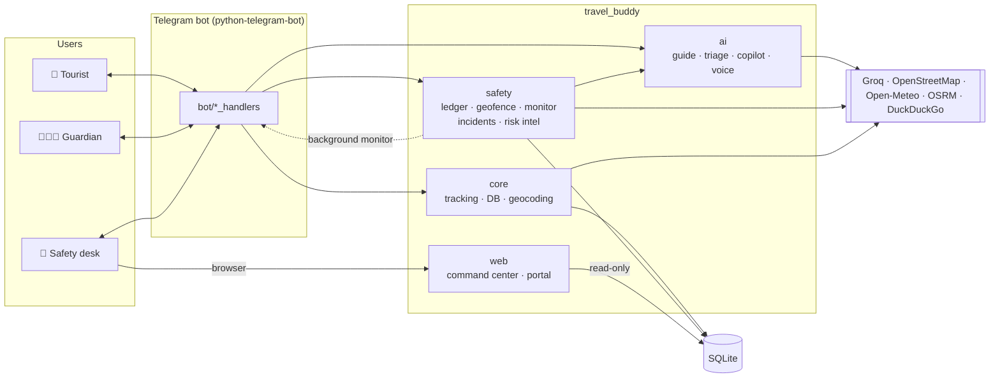
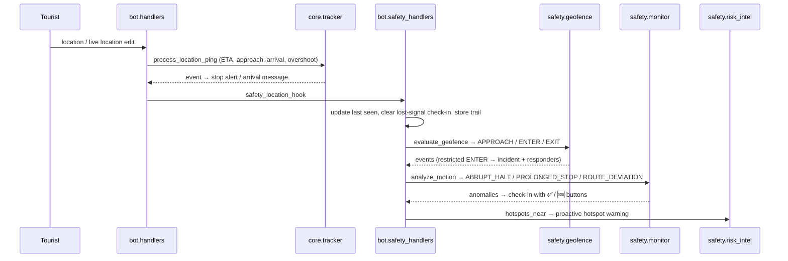
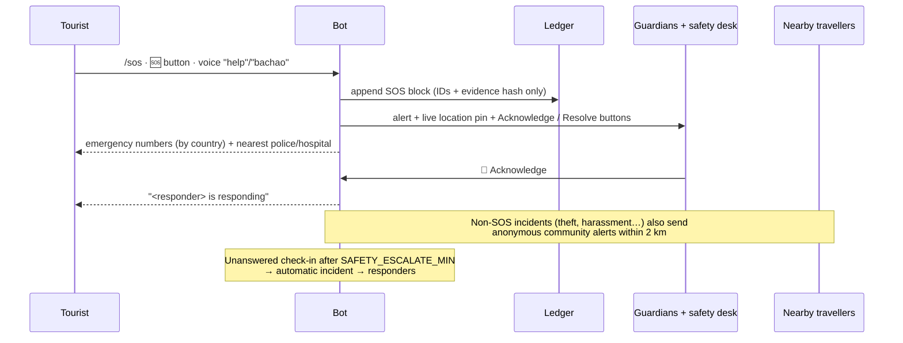

# Architecture

This document describes how Travel Buddy is organised, how data flows through it, and the design decisions behind the safety features.

- [System overview](#system-overview)
- [Package layout](#package-layout)
- [Request flows](#request-flows)
- [Data model](#data-model)
- [Blockchain ledger design](#blockchain-ledger-design)
- [Detection and scoring rules](#detection-and-scoring-rules)
- [External services](#external-services)
- [Design decisions](#design-decisions)

---

## System overview



The bot and the web portal run in **one process**. The Telegram application runs on the asyncio event loop. A background task (`safety.incidents.monitor_loop`) checks every 60 s for lost signal, expired timers, unanswered check-ins and severe weather. The web portal is a standard-library `ThreadingHTTPServer` on a daemon thread that reads SQLite read-only.

## Package layout

```
travel_buddy/
├── core/
│   ├── database.py        # users, trips, user_preferences (aiosqlite)
│   ├── tracker.py         # Haversine, speed smoothing, ETA, arrival/overshoot detection
│   └── geocoding.py       # Nominatim forward geocoding
├── ai/
│   ├── travel_guide.py    # /explore — DuckDuckGo search + Groq, preference-aware
│   ├── triage.py          # incident classification (Groq JSON mode + rule-based floor), safety briefings
│   └── copilot.py         # context-aware copilot, Whisper transcription, distress detection, phrasebook
├── safety/
│   ├── store.py           # safety schema + queries (IDs, ledger, incidents, zones, guardians, evidence…)
│   ├── ledger.py          # hash-chained proof-of-work ledger + Digital Tourist ID issue/verify/revoke
│   ├── geofence.py        # zone enter/exit/approach, emergency numbers, Overpass service lookup
│   ├── monitor.py         # motion anomaly detection + safety score
│   ├── incidents.py       # raise_incident, responder fan-out, community alerts, check-ins, monitor loop
│   └── risk_intel.py      # hotspot clustering, weather hazards, safe-route scoring
├── bot/
│   ├── handlers.py        # /start /help, trip wizard, live location pipeline, /explore, /preferences
│   ├── safety_handlers.py # ID, guardians, SOS, reports, E-FIR, zones, dashboard, callbacks
│   ├── intel_handlers.py  # copilot, voice, photo evidence, /saferoute /weather /hotspots /phrases, QR
│   └── keyboards.py       # persistent SOS keyboard
└── web/
    └── dashboard.py       # /command (token), /api/overview, /verify/<TID>, /ledger
```

**Dependency direction:** `bot → safety / ai / core`, `safety → ai / core`, `web → safety / core`. Nothing in `core` imports from the other packages. The two bot modules that need each other use local imports to avoid cycles.

## Request flows

### Live location update



### SOS and escalation



## Data model

| Table | Purpose |
|---|---|
| `users` | Telegram users and current trip status |
| `trips` | Journeys (destination, mode, status, alert flag) |
| `user_preferences` | AI guide personalisation (interests, budget, pace) |
| `tourist_ids` | Digital IDs: name, nationality, **salted hash** of the document number plus its last 4 characters, validity, identity hash, sealing block |
| `ledger` | Hash-chained blocks: `GENESIS`, `ID_ISSUED`, `ID_REVOKED`, `SOS`, `INCIDENT`, `INCIDENT_RESOLVED`, `EVIDENCE` |
| `guardians` | Single-use invite codes linked to guardian Telegram IDs |
| `incidents` | Type, severity, location, status lifecycle (`open → acknowledged → resolved`), source, AI advice, block hash |
| `evidence` | Photo / voice file IDs, SHA-256, transcript or caption, block hash |
| `geofence_zones` | Circular zones with risk level and advisory |
| `safety_state` | Per-user live state: last location, zones, pending check-in, timer, flags, alert de-duplication |
| `location_history` | Rolling 50-point trail per user (for E-FIR and search) |

Schema changes are applied at startup as idempotent `CREATE TABLE IF NOT EXISTS` / `ALTER TABLE ADD COLUMN` migrations.

## Blockchain ledger design

```
block_hash = SHA-256( index | timestamp | type | canonical_json(payload) | previous_hash | nonce )
valid      ⇔ block_hash starts with "000"  ∧  previous_hash == hash of block (index-1)
```

- **Tamper evidence:** changing any field of any block changes its hash, which breaks every later link. `verify_blocks()` recomputes the whole chain.
- **Identity binding:** the `ID_ISSUED` block seals `identity_hash = SHA-256(tourist_id, telegram_id, name, nationality, doc_type, doc_hash, validity)`. Verification recomputes it from the database row, so editing a stored ID is detected even when the chain itself is intact.
- **Privacy:** block payloads hold only IDs, hashes, types and severities. Names, phone numbers, locations and document numbers never enter the ledger.
- **Concurrency:** appends are serialised with an `asyncio.Lock`. Mining runs in a worker thread (`asyncio.to_thread`).

This is a single-node, permissioned ledger. It gives tamper evidence and an audit trail without the cost of a public chain. The `verify_blocks` / payload format is chain-agnostic, so block hashes could later be anchored to a public network.

## Detection and scoring rules

| Signal | Rule |
|---|---|
| Stop approaching | ETA ≤ 4 min or distance ≤ 1 km; arrival at ≤ 150 m; overshoot when moving away after closest approach |
| Geo-fence approach | ≤ 1 km from the edge of a `high` / `restricted` zone |
| Abrupt halt | Speed into stop ≥ 50 km/h, stationary within 100 m for ≥ 3 min, > 1.5 km from destination |
| Prolonged stop | Stationary ≥ 20 min mid-journey |
| Route deviation | 5 consecutive increasing distances to destination, total growth ≥ 2 km |
| Lost signal | Active trip, no location for `SAFETY_INACTIVITY_MIN` |
| Escalation | Check-in unanswered for `SAFETY_ESCALATE_MIN` → incident + responders |
| Hotspot | DBSCAN-style clustering, ε = 500 m, ≥ 2 incidents in 30 days; score = Σ severity × (0.3 + 0.7·e^(−age/10 d)) |
| Weather | Thunderstorm (WMO ≥ 95), heavy rain/snow, gusts ≥ 60 km/h, fog, feels-like ≥ 35/40 °C or ≤ −5 °C |

**Safety score** starts at 100 and subtracts points for each factor: zone risk (caution 15 / high 30 / restricted 40), late night (10), open incidents (20 each, max 2), recent anomalies (15 each, max 2), a pending check-in (20), no recent location (10), weather (5 / 15), a nearby hotspot (8 / 15), no digital ID (5) and no guardian (5).

**AI triage** never lowers severity below the rule-based classifier, so an outage or a model misjudgement cannot downgrade an emergency.

## External services

| Service | Used for | Key needed |
|---|---|---|
| Telegram Bot API | Messaging, files, location | `BOT_TOKEN` |
| Groq (Llama 3.3 70B, Whisper large-v3-turbo) | Guide, triage, copilot, briefings, voice | `GROQ_API_KEY` (optional; rule-based fallbacks) |
| OpenStreetMap Nominatim | Geocoding / reverse geocoding | No |
| OpenStreetMap Overpass | Nearby police, hospitals, pharmacies | No |
| Open-Meteo | Weather hazards | No |
| OSRM demo server | Road routes for `/saferoute` | No |
| DuckDuckGo | Grounding search for the guide and briefings | No |

Every network call has a timeout and degrades gracefully: features keep working with reduced detail when a service is unavailable.

## Design decisions

- **One process, no extra infrastructure.** SQLite plus a stdlib HTTP server keeps deployment to `python main.py`.
- **Privacy by default.** Hash-only ledger. Document numbers are never stored, and the message containing one is deleted from the chat. Community alerts are anonymous with only an approximate distance. The command center needs a secret token.
- **Fail safe, not silent.** Rule-based fallbacks exist for triage, distress detection and the copilot. Responders are only paged for medium-or-higher severity, while SOS always pages.
- **Testable cores.** Clustering, weather assessment, route scoring, the safety score and chain verification are pure functions. They are tested offline (`tests/test_intel.py`, `tests/test_safety.py`).
